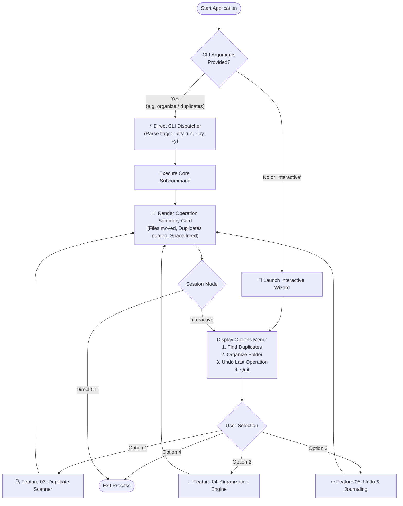
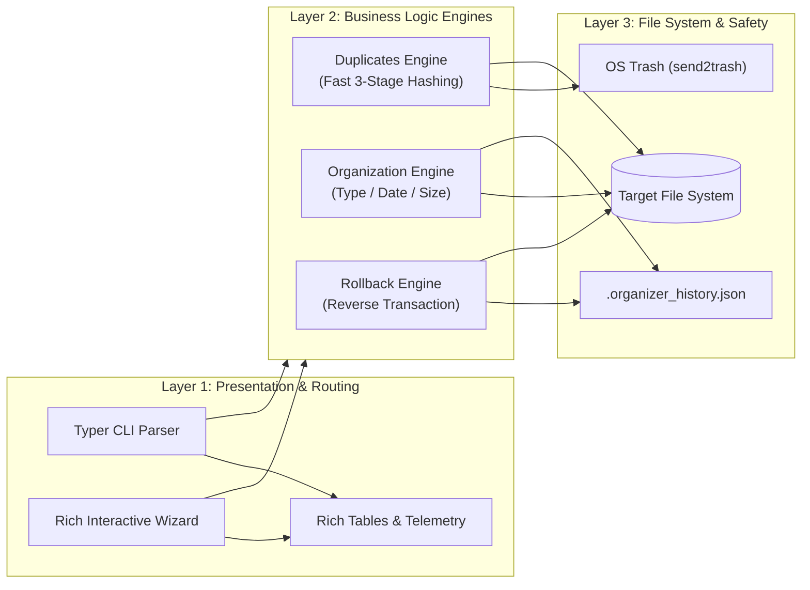

# Specification 01: System Overview & Dual Execution Modes

[← Back to Documentation Index](README.md)

---

## 1. Overview & Paradigm

The **Python File Organizer** is engineered with a **dual-mode architecture** to satisfy two distinct user personas:
1. **Interactive Users (Beginner / Desktop users):** Prefer a visual, conversational Terminal User Interface (TUI) with safety confirmations, progress bars, and guided choices.
2. **Automated / Scripting Users (Sysadmins / Developers):** Prefer composable, non-interactive CLI commands with flags (`--dry-run`, `-y`, `--by date`) suitable for cron jobs and shell scripts.

---

## 2. End-to-End System Flowchart

The following flowchart details how user input flows from initial entry through interactive or direct command routing:

---

## 3. High-Level Component Layers

---

## 4. Next Steps

* To inspect the step-by-step interactive navigation, see **[Specification 02: Interactive Wizard](02-interactive-wizard.md)**.
* To review direct terminal subcommands, see **[Specification 06: Direct CLI Reference](06-cli-reference.md)**.
