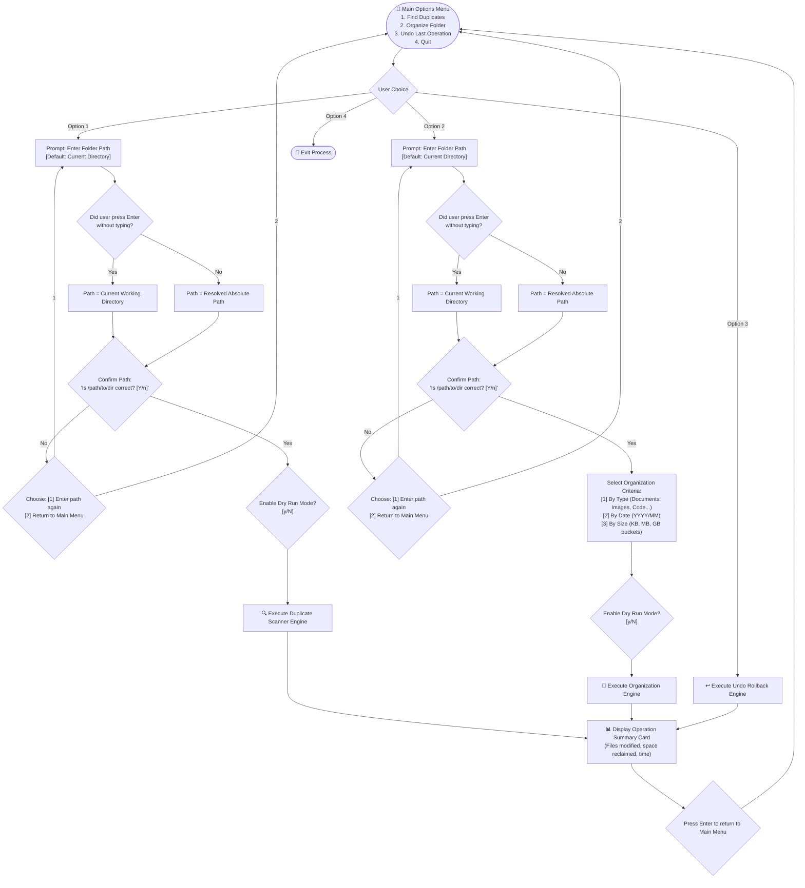

# Specification 02: Interactive TUI Wizard

[← Back to Documentation Index](README.md)

---

## 1. Overview & Purpose

The **Interactive Wizard** provides a safe, guided menu in the terminal. It ensures that the user never acts on the wrong directory by implementing:
1. **Default Path Fallback:** Pressing `[Enter]` automatically selects the current working directory (`.`).
2. **Path Confirmation Gate:** Confirms the resolved absolute path with the user before scanning.
3. **Retry / Main Menu Loop:** If a path is rejected, the user can re-enter it or return to the main menu without terminating the program.
4. **Dry-Run Toggle:** Explicit prompt asking whether to run in preview mode or apply real changes.
5. **Continuous Session:** After finishing an operation and viewing telemetry, the user is returned to the menu.

---

## 2. Interactive Navigation Flowchart



---

## 3. State Machine Specification

```mermaid
stateDiagram-v2
    [*] --> MainMenu

    state MainMenu {
        [*] --> PromptSelection
        PromptSelection --> Option1_Duplicates : Select '1'
        PromptSelection --> Option2_Organize : Select '2'
        PromptSelection --> Option3_Undo : Select '3'
        PromptSelection --> Terminated : Select '4'
    }

    state Option1_Duplicates {
        [*] --> InputPath_Dup
        InputPath_Dup --> Confirm_Dup
        Confirm_Dup --> DryRunPrompt_Dup : Yes
        Confirm_Dup --> RetryMenu_Dup : No
        RetryMenu_Dup --> InputPath_Dup : Retry
        RetryMenu_Dup --> MainMenu : Back to Menu
        DryRunPrompt_Dup --> RunningScanner
        RunningScanner --> ShowingSummary_Dup
    }

    state Option2_Organize {
        [*] --> InputPath_Org
        InputPath_Org --> Confirm_Org
        Confirm_Org --> SelectCriteria : Yes
        Confirm_Org --> RetryMenu_Org : No
        RetryMenu_Org --> InputPath_Org : Retry
        RetryMenu_Org --> MainMenu : Back to Menu
        SelectCriteria --> DryRunPrompt_Org
        DryRunPrompt_Org --> RunningOrganizer
        RunningOrganizer --> ShowingSummary_Org
    }

    state Option3_Undo {
        [*] --> ReadJournal
        ReadJournal --> ExecuteRollback
        ExecuteRollback --> ShowingSummary_Undo
    }

    ShowingSummary_Dup --> MainMenu : Continue
    ShowingSummary_Org --> MainMenu : Continue
    ShowingSummary_Undo --> MainMenu : Continue

    Terminated --> [*]
```

---

## 4. UI Prompts & Terminal Interaction Design

### Main Menu Interface
```text
╭──────────────────────────────────────────────────────────╮
│       📂  PYTHON FILE ORGANIZER (Interactive Mode)       │
│       Safe • Fast Multi-tier Hashing • Atomic Undo       │
╰──────────────────────────────────────────────────────────╯

Select an operation:
  [1] 🔍 Find & Remove Duplicates (Move to OS Trash)
  [2] 📁 Organize Folder (by Type, Date, or Size)
  [3] ↩️  Undo Last Operation
  [4] 🚪 Quit

Enter choice [1-4]: 
```

### Path Confirmation Gate
```text
Target Directory [Press Enter for current dir: /Users/amansingh/Downloads]: 
Target path set to: /Users/amansingh/Downloads
Is this path correct? [Y/n]: n

[1] Enter path again
[2] Return to Main Menu
Choice [1-2]: 
```

### Operation Summary Card
```text
╭────────────────── Operation Summary ──────────────────╮
│ Status:           ✅ Success                          │
│ Mode:             Live Execution (Dry Run: OFF)       │
│ Target Path:      /Users/amansingh/Downloads          │
│                                                       │
│ Files Organized:  142                                 │
│ Duplicates Found: 18 (Freed 1.2 GB of disk space)     │
│ Empty Dirs Purged:6                                   │
│ Elapsed Time:     0.82s                               │
╰───────────────────────────────────────────────────────╯
Press [Enter] to return to Main Menu...
```

---

## 5. Next Steps

* For duplicate scanning mechanics: **[Specification 03: Duplicate Scanner](03-duplicate-scanner.md)**
* For organization criteria: **[Specification 04: Organization Engine](04-organization-engine.md)**
