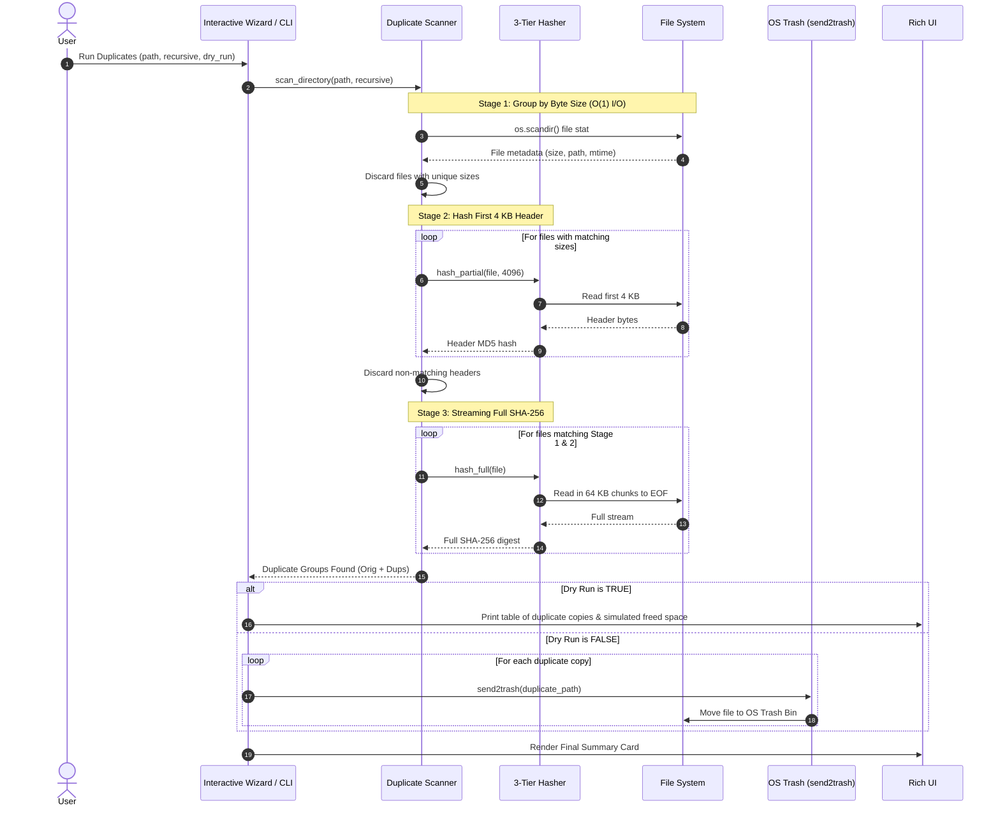

# Specification 03: Duplicate Scanner & Safe Trash

[← Back to Documentation Index](README.md)

---

## 1. Overview & Goal

The **Duplicate Scanner** detects bit-for-bit identical files across a folder (recursively or non-recursively) and cleans them up safely.

### Real-World Production Challenges & Solutions
1. **The I/O Bottleneck:** Computing full SHA-256 hashes on tens of thousands of large files will freeze the system.
   * *Solution:* **3-Stage Cascaded Hashing** (eliminates 95%+ of files with zero or minimal disk reading).
2. **Permanent Data Loss Risk:** Accidentally deleting files with `os.remove` is catastrophic.
   * *Solution:* **Native OS Trash Integration** (`send2trash`), allowing users to recover files from macOS Finder Trash or Windows Recycle Bin.
3. **Dry-Run Confidence:** Previewing exact duplicates and disk space to be reclaimed before acting.

---

## 2. Technical Sequence Diagram



---

## 3. Algorithm: 3-Stage Cascaded Filtration

$$\text{All Files} \xrightarrow[\text{Stage 1}]{O(1)\text{ Exact File Size}} S_{\text{cand}} \xrightarrow[\text{Stage 2}]{O(k)\text{ 4KB Partial Hash}} H_{\text{cand}} \xrightarrow[\text{Stage 3}]{O(N)\text{ Streaming SHA-256}} D_{\text{duplicates}}$$

### Stage 1: Size Binning ($O(1)$ disk access)
* Query file size via `os.stat().st_size`.
* Group files: `size_groups: dict[int, list[Path]]`.
* **Pruning:** If a size contains only 1 file, it is impossible for it to have a duplicate. It is discarded immediately with **0 bytes read from disk**.

### Stage 2: Partial Header Hash ($4\text{ KB}$ check)
* Two completely different 5 GB video files may happen to have identical sizes, but their header metadata will differ.
* Read the first 4,096 bytes ($4\text{ KB}$) and compute a fast partial hash.
* **Pruning:** Files whose 4 KB headers differ are discarded without reading the remaining 5 GB.

### Stage 3: Full SHA-256 Digest
* Computed in 64 KB buffer chunks only for files that passed Stages 1 and 2:
  ```python
  hasher = hashlib.sha256()
  with open(path, "rb") as f:
      while chunk := f.read(65536):
          hasher.update(chunk)
  return hasher.hexdigest()
  ```
* Files sharing the exact full SHA-256 are guaranteed bit-for-bit duplicates.

---

## 4. Retention Policy (Which file to keep?)

When duplicates are identified, which one is preserved?
* **Default Policy (Keep Oldest):** The file with the earliest creation/modification time (`min(st_mtime)`) is preserved as the original. All newer copies are marked as duplicates.
* **Alternative Policy (Keep Shortest Path):** Prefers keeping files in cleaner top-level directories rather than deep nested download subfolders.

---

## 5. Safe Trashing Mechanics (`send2trash`)

Instead of standard `os.remove()`:
```python
from send2trash import send2trash

try:
    send2trash(duplicate_path)
    # File is now in Trash / Recycle Bin, recoverable by user
except Exception as e:
    logger.error(f"Failed to trash {duplicate_path}: {e}")
```

---

## 6. Next Steps

* Review folder sorting: **[Specification 04: Organization Engine](04-organization-engine.md)**
* Review rollbacks: **[Specification 05: Undo & Journaling](05-undo-and-journaling.md)**
