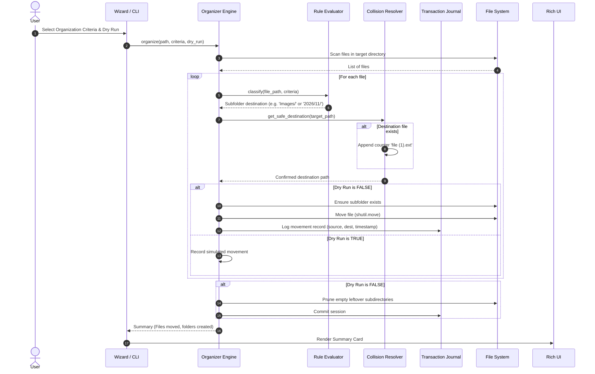
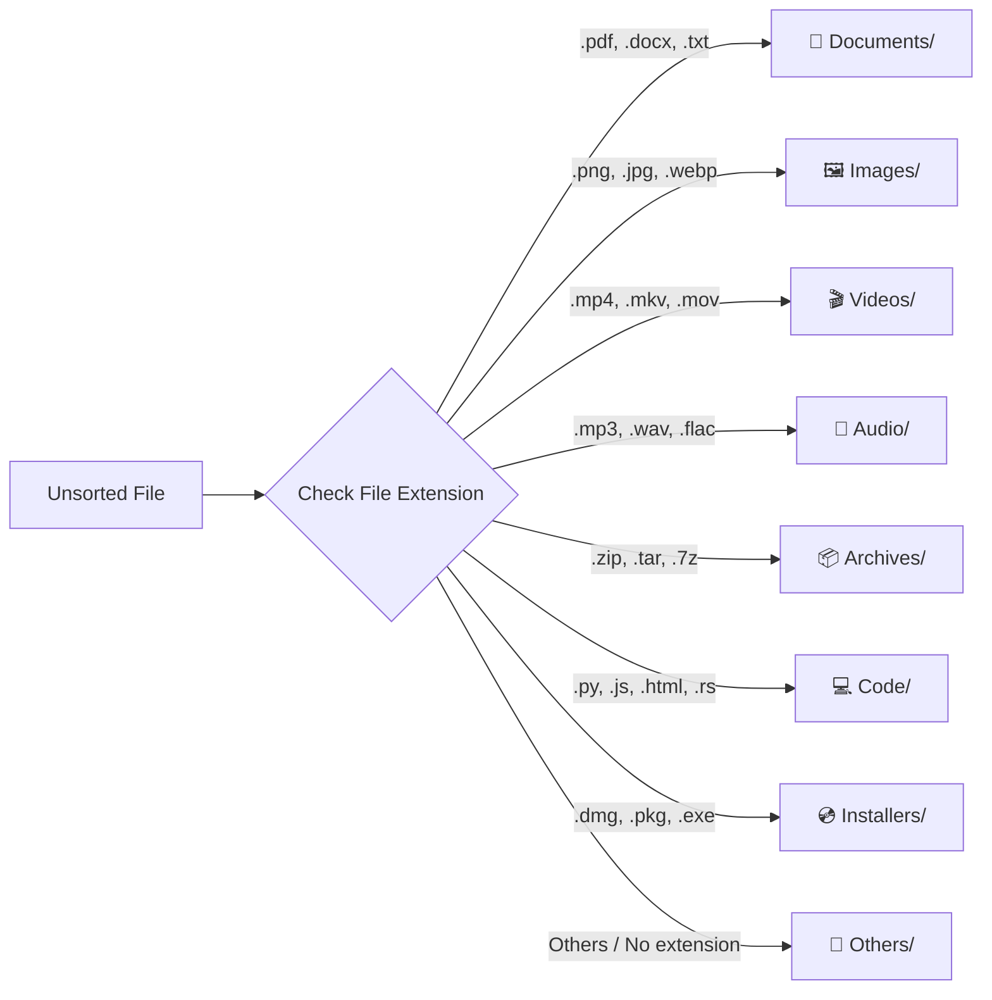

# Specification 04: File Organization Engine

[← Back to Documentation Index](README.md)

---

## 1. Overview & Goal

The **Organization Engine** automatically categorizes files in a target directory into organized subfolders according to selected criteria:
* **Option A: By Type** (extension-based classification, e.g. `Documents/`, `Images/`, `Code/`).
* **Option B: By Date** (chronological sorting into `YYYY/MM` folders).
* **Option C: By Size** (capacity thresholds, e.g. `Tiny/`, `Small/`, `Medium/`, `Large/`, `Huge/`).

Every file move is verified against collision conflicts and logged into the [Transaction Journal](05-undo-and-journaling.md) for full rollback capability.

---

## 2. Organization Workflow & Sequence



---

## 3. Categorization Strategies

### Strategy 1: By Type (File Extensions)
Default classification groups extensions into clean semantic categories:



### Strategy 2: By Date (Year / Month)
Extracts chronological metadata from:
1. **EXIF Metadata (Images):** Camera capture timestamp (`DateTimeOriginal`).
2. **File Modification Time (`st_mtime`):** Fallback for documents and downloaded files.

Generates structured directory trees:
```text
Target_Folder/
├── 2026/
│   ├── 2026-10/
│   │   ├── invoice_oct.pdf
│   └── 2026-11/
│       ├── photo_nov.jpg
```

### Strategy 3: By Size
Groups files into capacity buckets to quickly isolate disk space hogs:
* **Tiny:** $< 100\text{ KB}$ (text notes, icons, config files)
* **Small:** $100\text{ KB} - 10\text{ MB}$ (documents, regular photos)
* **Medium:** $10\text{ MB} - 100\text{ MB}$ (short clips, presentation decks, albums)
* **Large:** $100\text{ MB} - 1\text{ GB}$ (installers, movie files)
* **Huge:** $> 1\text{ GB}$ (virtual machine images, 4K footage)

---

## 4. Collision Resolution

When moving `source/report.pdf` to `dest/Documents/report.pdf`, what happens if `dest/Documents/report.pdf` already exists?

| Policy | Behavior | Example |
| :--- | :--- | :--- |
| **`rename` (Default)** | Deterministically appends an incrementing counter before the extension. | `report (1).pdf`, `report (2).pdf` |
| **`skip`** | Leaves the file in its original location and logs a skip warning. | Skipped without changes |
| **`overwrite`** | Overwrites the destination (requires explicit `--conflict overwrite`). | Overwrites target |

---

## 5. Pruning Leftover Empty Folders (`--clean-empty`)

After moving files into their new subfolders, empty source folders are pruned from the bottom up:
```python
def clean_empty_directories(root_path: Path) -> int:
    removed = 0
    for dirpath, dirnames, filenames in os.walk(root_path, topdown=False):
        if not dirnames and not filenames and Path(dirpath) != root_path:
            os.rmdir(dirpath)
            removed += 1
    return removed
```

---

## 6. Next Steps

* Review undo & rollback: **[Specification 05: Undo & Journaling](05-undo-and-journaling.md)**
* Review direct CLI commands: **[Specification 06: Direct CLI Reference](06-cli-reference.md)**
