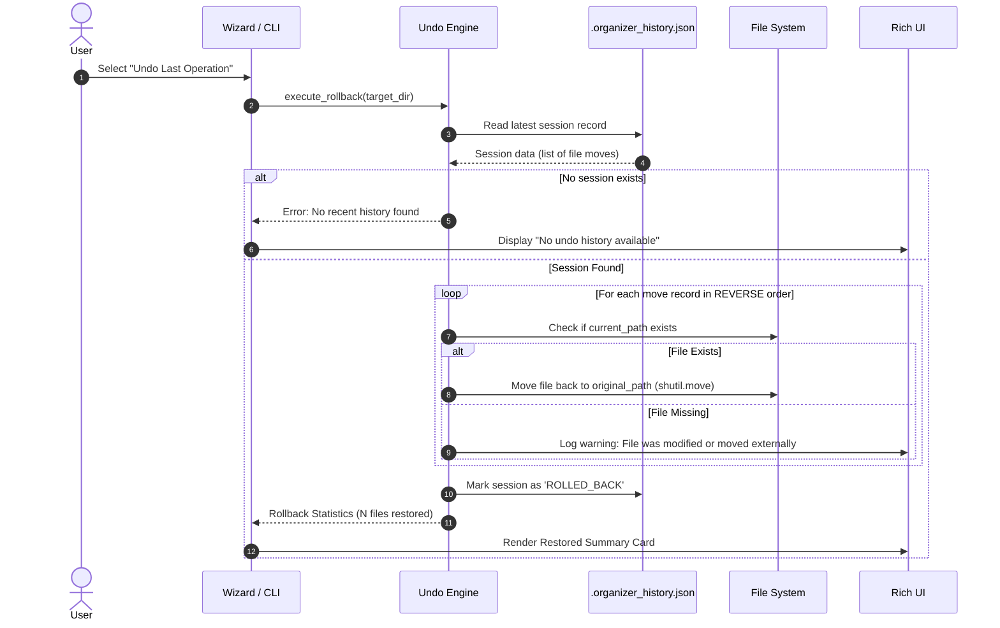

# Specification 05: Transaction Journal & Undo Rollback

[← Back to Documentation Index](README.md)

---

## 1. Overview & Purpose

The **Undo & Rollback Subsystem** gives users peace of mind. If files are organized into categories the user does not like, running `undo` (via Interactive Menu Option 3 or `python-file-organizer undo`) safely restores all moved files back to their exact previous locations.

---

## 2. Technical Sequence Diagram



---

## 3. Transaction Journal Schema (`.organizer_history.json`)

All modifying actions are recorded in a hidden `.organizer_history.json` file placed in the managed directory:

```json
{
  "version": "1.0",
  "sessions": [
    {
      "session_id": "9b1deb4d-3b7d-4bad-9bdd-2b0d7b3dcb6d",
      "timestamp": "2026-11-25T17:15:00Z",
      "command": "organize",
      "criteria": "type",
      "status": "COMPLETED",
      "actions": [
        {
          "original_path": "/Users/user/Downloads/notes.txt",
          "current_path": "/Users/user/Downloads/Documents/notes.txt",
          "file_size": 1024,
          "file_hash": "a1b2c3d4..."
        },
        {
          "original_path": "/Users/user/Downloads/screenshot.png",
          "current_path": "/Users/user/Downloads/Images/screenshot.png",
          "file_size": 204800,
          "file_hash": "e5f6g7h8..."
        }
      ],
      "purged_directories": [
        "/Users/user/Downloads/EmptyOldFolder"
      ]
    }
  ]
}
```

---

## 4. Reverse Restoration Algorithm & Safety Edge Cases

### 1. Reverse-Order Execution (LIFO)
Actions are undone in strict reverse order of execution (Last In, First Out). This ensures that if a file collision caused renaming (`file (1).ext`), the newest moves are unpacked before older ones.

### 2. Handling Missing Files
If a file was deleted or moved by the user externally after organization:
* The engine skips that file.
* It reports a warning in the terminal UI:
  `⚠️ Skipped /Downloads/Documents/deleted.pdf (File missing on disk)`
* It continues restoring the remaining valid files without crashing.

### 3. Re-creating Original Directories
If the original source folder was purged during organization, `os.makedirs(original_dir, exist_ok=True)` safely restores the parent folder before moving the file back.

---

## 5. Next Steps

* Review direct terminal commands: **[Specification 06: Direct CLI Reference](06-cli-reference.md)**
