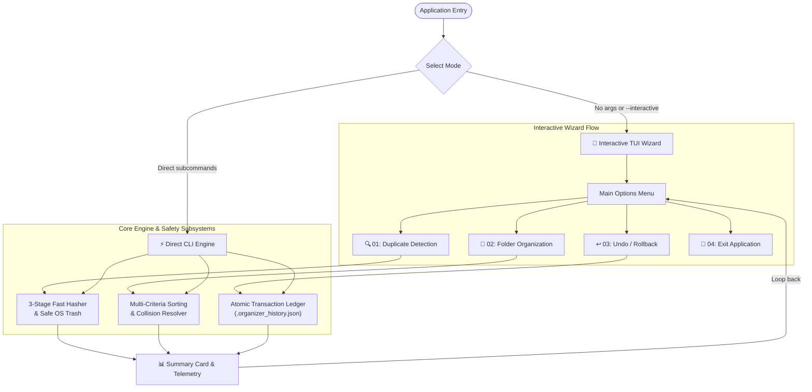

# 📂 System Architecture & Specifications Hub
## Python CLI File Organizer (`python-file-organizer`)

Welcome to the modular documentation for the **Python File Organizer**. This hub provides an overview of the system architecture and allows you to drill down into each individual subsystem.

---

## 🗺️ Visual Architecture Map

Click any feature below to inspect its detailed specification, technical flowcharts, and sequence diagrams:

---

## 📑 Feature Specification Modules

Explore each module for deep-dive specifications, algorithms, and sequence diagrams:

| Module | Title | Description | Link |
| :---: | :--- | :--- | :---: |
| **01** | **[System Overview & Modes](01-system-overview.md)** | High-level system architecture, dual execution modes, and safety principles. | [Read Spec →](01-system-overview.md) |
| **02** | **[Interactive TUI Wizard](02-interactive-wizard.md)** | Conversational menu loop, path confirmation gates, and state machine. | [Read Spec →](02-interactive-wizard.md) |
| **03** | **[Duplicate Scanner & Safe Trash](03-duplicate-scanner.md)** | 3-stage hashing pipeline ($O(1)$ size $\to$ 4KB chunk $\to$ SHA-256) & `send2trash`. | [Read Spec →](03-duplicate-scanner.md) |
| **04** | **[File Organization Engine](04-organization-engine.md)** | Sorting by Type, Date, or Size; collision handling (`rename/skip/overwrite`). | [Read Spec →](04-organization-engine.md) |
| **05** | **[Transaction Journal & Rollback](05-undo-and-journaling.md)** | Atomic undo system, journal schema, and reverse rollback sequence. | [Read Spec →](05-undo-and-journaling.md) |
| **06** | **[Direct CLI Reference](06-cli-reference.md)** | Non-interactive commands, options, exit codes, and scripting integration. | [Read Spec →](06-cli-reference.md) |

---

## 🛡️ Core Engineering Safeguards

1. **Non-Destructive by Default:** Permanent file deletion (`os.remove`) is prohibited. User duplicates are moved to the OS Trash.
2. **Deterministic Collision Handling:** Existing target files are never silently overwritten; they are auto-renamed (`file (1).ext`) unless explicitly instructed.
3. **Dry-Run Preview:** Every destructive operation supports preview mode to simulate changes before writing to disk.
4. **Atomic Rollback:** Reversible via `.organizer_history.json`.
